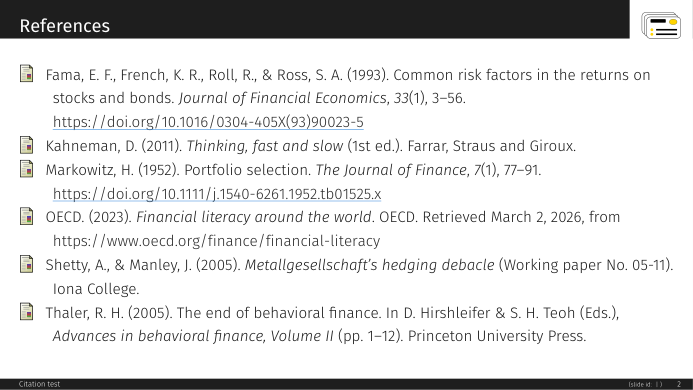

# APA 7

Author-year citations and a reference list after APA 7 (7th edition), through biblatex-apa.

{ loading=lazy }

!!! success "Nothing leaves your computer"
    A citation format is a TeX file; it contains no program and contacts no network service.

Works with SlideMage &gt;=0.13.0.

## Installing

In SlideMage: **Settings → Plugins → Citation formats → Add from GitHub…**, and type `SlideMage/slidemage-citation-apa`.

By hand: download [APA 7 1.0.0](https://github.com/SlideMage/slidemage-citation-apa/releases/download/v1.0.0/apa-1.0.0.smcite) (69 kB), then choose **Settings → Plugins → Citation formats → Add from file…**.

## Using it

In a template (between `\input{SlideMage_setup}` and `\input{SlideMage_base}`) or in a deck (before `\SMUseBibliography`):

```latex
\renewcommand{\SMCitationFormat}{apa}
```

## About this format

Author-year citations and a reference list after APA 7 (7th edition), through biblatex-apa. A SlideMage *citation format package* (`docs/CITATION_PACKAGE.md` in
[SlideMage](https://github.com/SlideMage/SlideMage)), key `apa`. It contains one TeX file and no program.

*The reference list on a SlideMage slide*

## What it looks like

In the text: `(Fama et al., 1993)`, `(OECD, 2023; Shetty & Manley, 2005)`, and `Kahneman (2011)` for `\textcite`.

In the list, the way APA 7 wants it, for example:

&gt; Fama, E. F., French, K. R., Roll, R., & Ross, S. A. (1993). Common risk factors in the returns on stocks and bonds. *Journal of Financial Economics*, *33*(1), 3-56. https://doi.org/10.1016/0304-405X(93)90023-5
&gt;
&gt; Thaler, R. H. (2005). The end of behavioral finance. In D. Hirshleifer & S. H. Teoh (Eds.), *Advances in behavioral finance, Volume II* (pp. 1-12). Princeton University Press.

It uses biblatex-apa (`style=apa`), which implements the 7th edition. Needs biblatex-apa in the TeX installation (MiKTeX installs missing packages on demand;
with TeX Live: `tlmgr install biblatex-apa`),
biber and lualatex, which SlideMage uses anyway.

## Install

In SlideMage 0.13.0 or later: **Settings → Extensions → Citation formats → Add from GitHub…** and type

    SlideMage/slidemage-citation-apa

or download `apa-<version>.smcite` and its `.sha256` from the latest release and use **Add from file…**.

## Choose it

In a template (between `\input{SlideMage_setup}` and `\input{SlideMage_base}`), or in a deck (before
`\SMUseBibliography`):

```latex
\renewcommand{\SMCitationFormat}{apa}
```

Then cite and list as always:

```latex
\parencite{fama1993}  \textcite{kahneman2011}  \footnote{\fullcite{fama1993}}
\printbibliography[heading=none]
```

A list on a slide is set in the theme's bibliography fonts, which are body size; for more than a few entries put
`\setbeamerfont{bibliography entry author}{size=\small}` (and the same for `title`, `location`, `note`) before
`\printbibliography`, or split the list over frames with `\begin{frame}[allowframebreaks]`.

## Notes

- Titles of articles, books and chapters are set in sentence case by biblatex-apa itself; proper nouns and
  acronyms in a title that must keep their capitals need braces in the `.bib` file (`title = {The {OECD} ...}`).
- A publisher or institution name containing "and" needs double braces (`publisher = {{Farrar, Straus and Giroux}}`),
  otherwise biblatex reads it as two names.
- biblatex-apa expects `@online` for web pages and `@report` for reports and working papers.
- A project's own copy of `SlideMage_citation_apa.tex` wins over the installed one, which freezes a version.

## Licence

The TeX file is LPPL-1.3c-or-later; see `LICENSE`.

## Versions

| Version | SlideMage | Released | Download |
|---|---|---|---|
| 1.0.0 | &gt;=0.13.0 | 2026-11-06 | [.smcite](https://github.com/SlideMage/slidemage-citation-apa/releases/download/v1.0.0/apa-1.0.0.smcite) · [notes](https://github.com/SlideMage/slidemage-citation-apa/releases/tag/v1.0.0) |

## Changelog

### v1.0.0 (2026-11-06)

First release: the APA 7 citation format for SlideMage 0.13.0 or later.

- `SlideMage_citation_apa.tex`: biblatex-apa (`style=apa`), which implements the 7th edition, adapted to SlideMage's slides (beamer's bibliography fonts and
  item icon, the footnote form of `\fullcite`).
- Tested with lualatex and biber on `@article`, `@book`, `@incollection`, `@report`, `@online` and a work with four
  authors, with `\parencite`, `\textcite`, `\cite` and `\fullcite` in a footnote.

---

Maintained by Stefan Palan · License LPPL-1.3c-or-later · [Source](https://github.com/SlideMage/slidemage-citation-apa)
