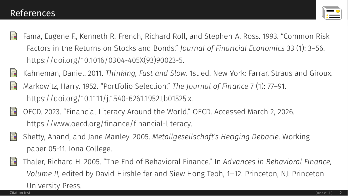

# Chicago author-date

Author-date citations and a reference list after the Chicago Manual of Style, 17th ed., through biblatex-chicago.

{ loading=lazy }

!!! success "Nothing leaves your computer"
    A citation format is a TeX file; it contains no program and contacts no network service.

Works with SlideMage &gt;=0.13.0.

## Installing

In SlideMage: **Settings → Plugins → Citation formats → Add from GitHub…**, and type `SlideMage/slidemage-citation-chicago`.

By hand: download [Chicago author-date 1.0.0](https://github.com/SlideMage/slidemage-citation-chicago/releases/download/v1.0.0/chicago-1.0.0.smcite) (72 kB), then choose **Settings → Plugins → Citation formats → Add from file…**.

## Using it

In a template (between `\input{SlideMage_setup}` and `\input{SlideMage_base}`) or in a deck (before `\SMUseBibliography`):

```latex
\renewcommand{\SMCitationFormat}{chicago}
```

## About this format

Author-date citations and a reference list after the Chicago Manual of Style, 17th ed., through biblatex-chicago. A SlideMage *citation format package* (`docs/CITATION_PACKAGE.md` in
[SlideMage](https://github.com/SlideMage/SlideMage)), key `chicago`. It contains one TeX file and no program.

*The reference list on a SlideMage slide*

## What it looks like

In the text: `(Fama et al. 1993)`, `(Shetty and Manley 2005; OECD 2023)`, and `Kahneman (2011)` for `\textcite`.

In the list, for example:

&gt; Fama, Eugene F., Kenneth R. French, Richard Roll, and Stephen A. Ross. 1993. "Common Risk Factors in the Returns on Stocks and Bonds." *Journal of Financial Economics* 33 (1): 3-56. https://doi.org/10.1016/0304-405X(93)90023-5.
&gt;
&gt; Thaler, Richard H. 2005. "The End of Behavioral Finance." In *Advances in Behavioral Finance, Volume II*, edited by David Hirshleifer and Siew Hong Teoh, 1-12. Princeton, NJ: Princeton University Press.

It uses biblatex-chicago (`authordate`, the 17th edition's author-date system). Needs biblatex-chicago and xstring in the TeX installation (MiKTeX installs missing packages on demand;
with TeX Live: `tlmgr install biblatex-chicago xstring`),
biber and lualatex, which SlideMage uses anyway.

## Install

In SlideMage 0.13.0 or later: **Settings → Extensions → Citation formats → Add from GitHub…** and type

    SlideMage/slidemage-citation-chicago

or download `chicago-<version>.smcite` and its `.sha256` from the latest release and use **Add from file…**.

## Choose it

In a template (between `\input{SlideMage_setup}` and `\input{SlideMage_base}`), or in a deck (before
`\SMUseBibliography`):

```latex
\renewcommand{\SMCitationFormat}{chicago}
```

Then cite and list as always:

```latex
\parencite{fama1993}  \textcite{kahneman2011}  \footnote{\fullcite{fama1993}}
\printbibliography[heading=none]
```

A list on a slide is set in the theme's bibliography fonts, which are body size; for more than a few entries put
`\setbeamerfont{bibliography entry author}{size=\small}` (and the same for `title`, `location`, `note`) before
`\printbibliography`, or split the list over frames with `\begin{frame}[allowframebreaks]`.

## Notes

- The format loads biblatex-chicago's own package (`\RequirePackage[authordate,footmarkoff]{biblatex-chicago}`)
  after SlideMage has loaded biblatex, so the Chicago options, language files and punctuation come from
  biblatex-chicago and not from a copy of them. `footmarkoff` keeps SlideMage's footnote layout.
- In the author-date style biblatex-chicago prints only the short citation for `\fullcite`; the format makes
  `\fullcite` print the full reference, as SlideMage's slides expect for a footnote.
- Authors are listed up to ten, then the first seven and "et al.", as the Manual says.
- A project's own copy of `SlideMage_citation_chicago.tex` wins over the installed one, which freezes a version.

## Licence

The TeX file is LPPL-1.3c-or-later; see `LICENSE`.

## Versions

| Version | SlideMage | Released | Download |
|---|---|---|---|
| 1.0.0 | &gt;=0.13.0 | 2026-11-06 | [.smcite](https://github.com/SlideMage/slidemage-citation-chicago/releases/download/v1.0.0/chicago-1.0.0.smcite) · [notes](https://github.com/SlideMage/slidemage-citation-chicago/releases/tag/v1.0.0) |

## Changelog

### v1.0.0 (2026-11-06)

First release: the Chicago author-date citation format for SlideMage 0.13.0 or later.

- `SlideMage_citation_chicago.tex`: biblatex-chicago (`authordate`, the 17th edition's author-date system), adapted to SlideMage's slides (beamer's bibliography fonts and
  item icon, the footnote form of `\fullcite`).
- Tested with lualatex and biber on `@article`, `@book`, `@incollection`, `@report`, `@online` and a work with four
  authors, with `\parencite`, `\textcite`, `\cite` and `\fullcite` in a footnote.

---

Maintained by Stefan Palan · License LPPL-1.3c-or-later · [Source](https://github.com/SlideMage/slidemage-citation-chicago)
