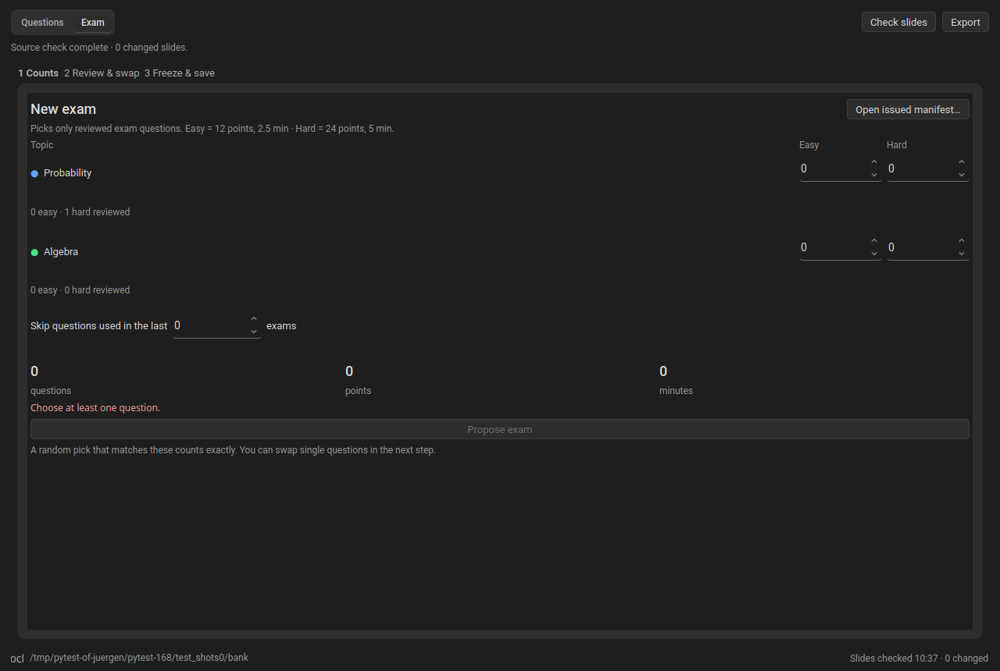
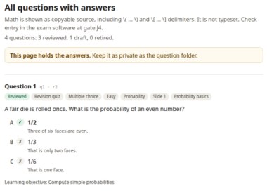
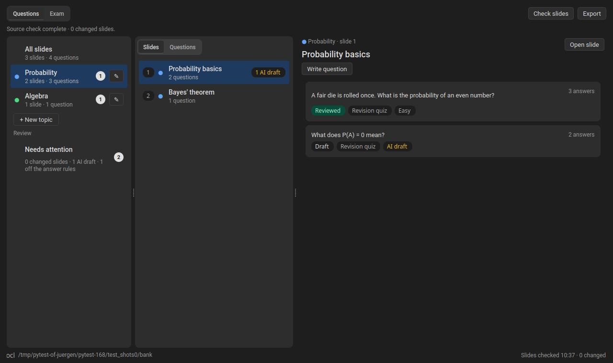

# Exam Forge

{ width="64" } Exam questions linked to the material you taught, with clearly documented AI use. Review, export, assemble exams.

!!! success "Nothing leaves your computer"
    This plugin contacts no network service.

## Requirements

Nothing beyond SlideMage.

Works with SlideMage &gt;=0.13.31.

## Installing

In SlideMage: **Settings → Plugins** or **Help → Plugins…**.

By hand: download [Exam Forge 0.10.2](https://github.com/SlideMage/slidemage-plugin-exam-forge/releases/download/v0.10.2/exam-forge-0.10.2.smplugin) (108 kB), then choose **Settings → Plugins → Install from file…**.

## About this plugin

A [SlideMage](https://slidemage.org) plugin for writing exam questions for a deck and assembling exams.

**Open:** Deck menu → **Exam Forge…** · **Requires:** SlideMage 0.13.18 or later

## Questions

*Questions tab*

**The bank holds answer keys and rationales: keep its folder private.** Choose the folder on first use; **Change folder…** in Settings moves it.

- Group slides into **topics**; a question's topic is that of its first linked slide.
- Questions are **Multiple choice** or, for exams, **Open answer**, either **Easy** or **Hard**, for a **Revision quiz** or an **Exam**. Each can have images (with descriptions) and a note for teaching assistants. That note appears in the exam: never put answers in it.
- **Answer rules** (Settings) set how many answers and correct answers a question has, per deck.
- Every save creates a draft revision. **Mark reviewed** needs a linked slide.
- Changed slides are flagged. **Review changes** compares old and new text.

**AI use: Clearly Documented** (off by default, Settings)

- **Draft with AI** writes questions from chosen slides. Answer keys are never sent.
- **Update with AI** drafts a revision of a question whose slide changed.
- Replies arrive as **AI draft** until you review them.
- **AI-assisted** is a permanent label on every question an AI drafted or revised.

## Export

*Question page export*

The **Export** menu holds the answers: keep the files private.

- **Moodle quiz (XML):** reviewed revision-quiz questions. Moodle import is not yet verified.
- **Question table (CSV):** every question, one row each.
- **Question page (HTML):** every question with its answers, like the exam key.

## Exams

*Exam tab*

The **Exam** tab: set easy and hard counts per topic, review and swap the proposal, then **Approve and freeze**. This issues a manifest in the bank folder and saves an exam copy and a private key (HTML). **Record a correction…** logs later changes.

Easy questions are worth 12 points and 2.5 minutes, hard ones 24 points and 5 minutes.

## Compatibility

Banks from versions before 0.10.0 are upgraded when written, and older versions cannot read them: update every machine that shares a bank.

## Screenshots

{ loading=lazy }

{ loading=lazy }

{ loading=lazy }

## Versions

| Version | SlideMage | Released | Download |
|---|---|---|---|
| 0.10.2 | &gt;=0.13.31 | 2026-11-03 | [.smplugin](https://github.com/SlideMage/slidemage-plugin-exam-forge/releases/download/v0.10.2/exam-forge-0.10.2.smplugin) · [notes](https://github.com/SlideMage/slidemage-plugin-exam-forge/releases/tag/v0.10.2) |

## Changelog

### v0.10.2

*2026-11-03 · calmer pages*

The exported HTML pages have a new look.

NEW: The HTML pages look calmer.
- Answers get a ✓ or ✗ marker, the heading is shorter, and status and slide appear as labels.

### v0.10.1

*2026-11-03 · export menu*

One Export menu replaces the three export buttons in the window header.

NEW: Choose a question-bank export from the Export menu.
- Moodle quiz (XML), Question table (CSV) and Question page (HTML) keep their existing export behaviour, confirmations and default question folder.
- Each option has a description; an amber Answer key chip marks the table and page. Unavailable options explain why in a tooltip.
- Use Up, Down and Enter to choose an export, or Escape or click away to close the menu. The hint at the bottom points to the Exam tab for exams.

### v0.10.0

*2026-11-02 · slides or questions, a table, answer rules, and open answers*

The middle column of the Questions tab shows either the slides or the questions, Export table saves the whole question set as a CSV table, each deck sets its own answer rules, and an exam can have open-answer questions. ELP exams are now called exams.

NEW: Switch the middle column between Slides and Questions, export every question as a table, set a deck's answer rules, and write open-answer exam questions.
- Slides lists the slides of the chosen topic, each with how many questions it has, as before.
- Questions lists the topic's questions in the order of their slides, retired ones last. Click one to open it.
- Export table saves a CSV table with one row per question: status, use, type, difficulty, topic, linked slides, learning objective and the note for teaching assistants, then each answer's text, whether it is correct, and its rationale, or an open question's model answer and grading notes.
- The table holds the answer key, so keep it private. It opens in Excel or LibreOffice with accents and mathematics intact.
- Settings, Exam Forge, Answer rules: which question types the deck's exam uses (multiple choice, open answer, or both), and how many answers a revision quiz and a multiple-choice exam question have and how many are correct. The rules are kept in the deck's question folder.
- An open-answer question has a model answer and grading notes, which only the private key shows. The exam copy leaves room to write, and the scoring sheet says it is graded by hand. Draft with AI and Update with AI write open-answer questions too.
- When the exam uses both types, the Counts step sets how many of each per topic and difficulty.
- Revision quizzes that allow several correct answers export to Moodle as multiple-response questions.
- Exams with another number of answers get a matching scoring sheet. Settings refuses rules that would not give whole points per tick.
- Reviewed questions that no longer fit are marked Off the answer rules and listed under Needs attention, and exports and exam proposals leave them out.
- ELP exams are now just exams: in the editor, the Exam tab and the exam documents.
- Export HTML saves every question with its answers as one page, laid out like the exam key, with images.
- Export table, Export HTML and Export to Moodle open in the deck's question folder.
- When an AI request ends without a reply, Draft with AI and Update with AI say so instead of closing without a word.

FIXED: Choosing another slide or topic while a question is open no longer leaves the right panel stuck.
- It showed the closed question, disabled and ignoring every click, until you switched views.

### v0.9.0

*2026-11-02 · any language of the project, with SlideMage v0.13.31*

Questions can be drafted from slides in any language of the project, not only English and German. Requires SlideMage v0.13.31.

NEW: Exam Forge works with every language of your project.
- Draft questions lists the project's languages, the deck's own first selected; a slide read in French is linked in French.
- The ELP exam copy and key sheet are marked with the deck's language, so a screen reader reads them in it.

### v0.8.0

*2026-11-02 · question images and folder*

Images now sit directly under the question text, with previews, and Settings can change a deck's question folder.

NEW: Adding an image to a question is quick, and a deck's question folder can change.
- Add a file, use Paste image, or paste or drop an image into the question. Each image shows a preview and its description right there, instead of in a folded list at the bottom.
- Question lists and exam proposals show how many images a question has.
- Change the open deck's question folder in Settings, Exam Forge. An empty folder receives a checked copy of the bank's files. The old folder is not changed, so delete it yourself once you have checked the new one.
- A folder that already has a bank is used as it is, after you confirm; nothing is merged.

CHANGED: Rules for images.
- Every image needs a description before a question can be marked reviewed.
- SVG files can no longer be added, because ELP exams cannot include them. The file's content now decides whether it is accepted, not its name.

### v0.7.0

*2026-11-01 · plugin UI kit restyle*

The window, its lists and its dialogs are built from SlideMage's own widgets (requires SlideMage 0.13.18). The window is a Host.Window, so SlideMage closes it with itself and unsaved work can stop that.

NEW: Exam Forge looks like SlideMage, in light and dark.
- Cards, switches, list rows with count badges and SlideMage's type scale replace the plain window, and the dialogs are SlideMage sheets.
- Used for and Difficulty now show which option is on.
- Slide titles show without LaTeX markup.
- The Exam Forge box in the sidebar has an Open Exam Forge button.
- Short messages such as a saved draft appear for a moment at the bottom of the window.

### v0.6.1

*2026-11-01 · version fix*

SlideMage 0.13.13 to 0.13.16 do not have the plugin calls Exam Forge needs; those calls ship in 0.13.17.

NEW: Exam Forge now asks for SlideMage 0.13.17 or newer.
- On older versions SlideMage now says a newer version is needed, instead of Exam Forge failing when a call is missing.

### v0.6.0

*2026-11-01 · topics and redesigned window*

Group slides into topics, review changed slides and build exams with easy and hard counts per topic.

NEW: Questions and Exam tabs built around slides and topics.
- Topics replace the free-text topic. A topic is a group of slides stored in topics.json; each slide is in at most one topic, and a question's topic is the topic of its first linked slide. Existing topics are migrated automatically on first open and conflicts are reported once.
- The Questions tab lists topics, slides and the questions for a slide, with Needs attention and Unlinked questions. Check slides and Export to Moodle replace the earlier button names.
- Review changes compares old and new slide text. Still correct keeps the question's status with a new baseline; Update with AI sends that question with its answer key and the current slide text, and records a permanent AI-assisted edit.
- Draft with AI pre-ticks the slide it was opened from and no longer proposes a topic. Marking a question reviewed requires a linked slide.
- The Exam tab has three steps with easy and hard counts per topic; minutes and points follow from the counts. Approval is blocked while a picked question has a changed slide. Exam copy and private key are saved separately and cannot share a file.
- Bank file format is now version 2 and stores a text snapshot of each linked slide, also in issued manifests. Version 1 files stay readable and are upgraded when next written; older plugin versions cannot read upgraded files. Issued manifests from older versions still open.

### v0.5.1

*2026-11-01 · SlideMage version scheme*

Requires SlideMage 0.13.13, the release with Host.ai_chat(), under its new version numbering.

NEW: Exam Forge follows SlideMage's new version numbers.
- It now asks for SlideMage 0.13.13 or later.

### v0.5.0

*2026-10-30 · bulk AI drafting*

Generate multiple drafts in one request.

NEW: Bulk AI drafting.
- Generate 1–30 drafts from selected slides, each linked to its identified source; invalid, truncated or incorrectly sized replies are refused in full.

### v0.4.1

*2026-10-30 · AI host contract*

Use the direct host AI chat call.

NEW: AI drafting uses the host AI chat interface.
- Request AI chat through the host and handle AiChatError.

### v0.4.0

*2026-10-30 · focused exam assembly*

Assemble exams from all reviewed ELP questions.

NEW: The window has Bank and Exam tabs.
- Remove presentation logging and the taught-only filter; retain blueprint exclusions and source checks.

### v0.3.3

*2026-10-30 · focused workflows*

Streamline question writing, revision quizzes and ELP exams.

NEW: Exam proposals use topic counts, fixed ELP rules and an automatically generated seed.
- Keep the seed and scoring rules in the frozen manifest. Slides filtering starts on each time.
- Remove deck defaults, manual seed and scoring controls, objective counting, duplicate manifest and sidebar open buttons, bank search, and drafting image descriptions.

### v0.3.2

*2026-10-30 · presentation logs*

Simplify Sessions to logged presentations.

NEW: Sessions lists logged presentations.
- Remove manual sessions and recording and transcript attachments. Presentation logs continue to support the Slides filter and cached schedules provide labels and fallback coverage.

### v0.3.1

*2026-10-30 · drafting guidance*

Customize AI drafting guidance in Settings.

NEW: Customize AI drafting guidance.
- Edit or reset question drafting guidance while retaining the required answer format and source evidence rule.

### v0.3.0

*2026-10-30 · AI drafting*

Draft questions from explicitly chosen teaching sources through the host's optional AI chat service.

NEW: Enable AI support in Settings to show Draft with AI in the Bank tab.
- Choose slides; transcripts are not sent. Preview source text and explicitly review image descriptions for exam use before including them; the review tick starts off.
- Build one text-only request without bank keys, rationales, recordings, student records or attachment metadata. The host handles route selection and cloud confirmation; decline and cancel quietly add nothing.
- Refuse malformed or truncated replies in full. Save valid replies as drafts with permanent route/model provenance, retain the amber AI draft label until review, and use the existing source-check and review lifecycle.
- Preserve an empty model name when the host reports a provider's default model.

### v0.2.0

*2026-10-30 · phase 2 interface*

Assemble, approve and issue ELP exams from the existing bank.

NEW: Bank, Exam and Sessions tabs connect the phase 2 modules in the existing window.
- Record presentations after activation, label sessions from an optional cached schedule, attach recordings and transcripts, read parsed transcripts, and open recordings in the system player.
- Save the deck-default Slides filter, confirm estimated cut-offs, inspect exclusions and infeasible blueprints, swap questions and approve after fresh source checks.
- Issue immutable manifests in the bank folder, reopen them, save exam and private key HTML through dialogs, and record corrections in a separate sheet with one journal writer at a time.
- Edit a teaching-assistant note for shared stems, exclusions and fixed option order. Freeze it with the question and mark it in the exam entry copy; Moodle XML ignores it.

### v0.1.0

*2026-10-30 · phase 1 bank editor*

Create and review deck questions and export them to Moodle XML.

NEW: Exam Forge provides a private question bank for each deck.
- Open a reusable, non-modal Exam Forge window from the Deck menu, with status, use, topic, source-change and AI-draft filters.
- Create and edit questions, attach bank-stored images and link source slides by view and language. Edits create draft revisions and preserve reviewed history.
- Check sources on open, on demand and before status changes; retain Source changed and permanent AI-assisted labels.
- Show compact bank counts in the sidebar and start a question from the slide in focus.
- Recover save conflicts by keeping edits or saving a separate question. Export filtered, reviewed revision questions with verified images to Moodle XML.
- Choose or relocate a private bank folder on first use, with confirmation for folders that may be shared.

---

Maintained by Jürgen Fleiß · License GPL-3.0-or-later · [Source](https://github.com/SlideMage/slidemage-plugin-exam-forge)
